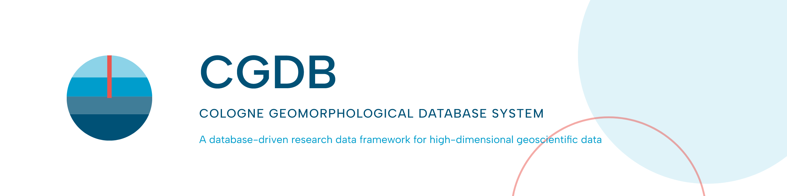
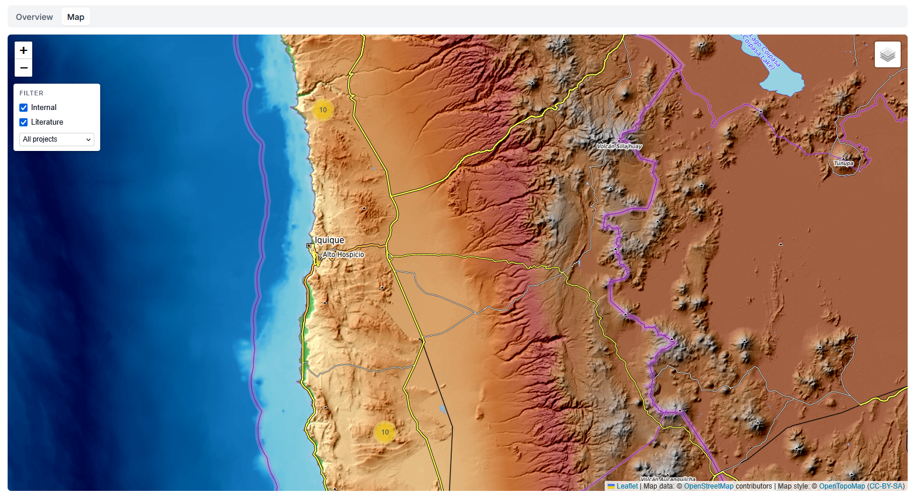
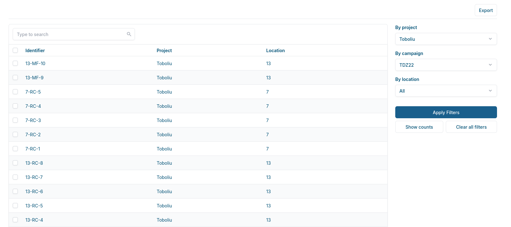

The Cologne Geomorphological Database System (CGDB) is a Django application for geoscientific research data, from field sampling to laboratory results. It is written for small research projects that have to meet the data management requirements of their funders but have no staff for data management.

CGDB records locations, layers and samples together with their laboratory analyses: luminescence, radiocarbon and cosmogenic nuclide dating, grain size, pollen counts, geochemistry and micro-XRF. It also keeps the instruments and methods used and the literature the data comes from. Access is granted per project and per role. The data can be edited in the admin, viewed on a map, queried through a REST API and exported to DuckDB for analysis.





## Try the demo

With Docker installed, one command starts CGDB with a PostGIS database and synthetic data:

```
docker compose -f compose.demo.yml up
```

Then open http://localhost:8000 and log in as `demo_pi` with the password `demo`. The demo runs with `DEBUG` on and a known password and is not a production setup. See [Try the demo](https://cologne-geomorphological-software-lab.github.io/CGDB/getting-started/demo.html) for the second account, resetting the data and what needs internet access.

## Documentation

The documentation is at **https://cologne-geomorphological-software-lab.github.io/CGDB/**:

- [Installation for local development](https://cologne-geomorphological-software-lab.github.io/CGDB/getting-started/installation.html)
- [Deployment](https://cologne-geomorphological-software-lab.github.io/CGDB/operations/deployment.html), [roles and projects](https://cologne-geomorphological-software-lab.github.io/CGDB/operations/roles-and-projects.html), [protected files](https://cologne-geomorphological-software-lab.github.io/CGDB/operations/protected-files.html) and [data orchestration](https://cologne-geomorphological-software-lab.github.io/CGDB/operations/orchestration.html)
- [Running the tests](https://cologne-geomorphological-software-lab.github.io/CGDB/development/testing.html)
- [REST API](https://cologne-geomorphological-software-lab.github.io/CGDB/reference/rest-api.html) and [data model](https://cologne-geomorphological-software-lab.github.io/CGDB/reference/models.html)

Its sources are in [`docs/source/`](docs/source/); build them locally with `cd docs && make html`. Release notes are in [CHANGELOG.md](CHANGELOG.md), upgrade steps for major versions in [MIGRATING.md](MIGRATING.md), and how to contribute in [CONTRIBUTING.md](CONTRIBUTING.md). Report security problems as described in [SECURITY.md](SECURITY.md).

## Built with

[Django](https://www.djangoproject.com/) and GeoDjango, [Django Unfold](https://github.com/unfoldadmin/django-unfold), [Django REST Framework](https://www.django-rest-framework.org/), [OpenLayers](https://openlayers.org/) with [Vite](https://vitejs.dev/), [Dagster](https://dagster.io/), [DuckDB](https://duckdb.org/) and [uv](https://docs.astral.sh/uv/).

## Citing CGDB

> Handy, D. and van der Meij, M.: CGDB: Cologne Geomorphological Database System, Zenodo [code], https://doi.org/10.5281/zenodo.17869730, 2026.

> Handy, D., van der Meij, W. M., Zickel, M., and Reimann, T.: A database-driven research data framework for integrating and processing high-dimensional geoscientific data, Geosci. Instrum. Method. Data Syst., 15, 165–181, https://doi.org/10.5194/gi-15-165-2026, 2026.

Citation metadata for the current release are in [CITATION.cff](CITATION.cff).

## License

MIT License, see [LICENSE](LICENSE).
